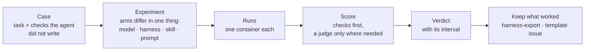

# Harness Lab

!!! info "About this page"
    **What you will learn:** what the Harness Lab answers, how to start in 30 seconds or 15 minutes, and what it will and will not tell you.

    **For:** developers, tech leads, AI champions, and Harness Engineers who want evidence instead of impressions.

    **Read this when:** you doubt a skill, a model, or a rule and want to know whether it actually helps.

Find out, with numbers instead of impressions, whether your AI coding setup works, and which model, harness, or skill makes it work better.

A *harness* is everything around a coding agent that is not the model: the rules file, the skills, the agents, the hooks, the working loop. Teams usually write it by feel. The lab measures it. You bring a task, a repository, or a skill; it runs coding agents on it in isolated containers under the configurations you choose, scores every run against checks the agent did not write, and tells you how sure it is.

## What you can do with it

- **Check your repository's harness** in about 30 seconds, with no model: the eight checks of the [harness health check](../../harness-kit/health-check.md).
- **Compare models** on the same cases, several times each: which one does the job, and whether the harness helps a small model more than a large one.
- **Measure a skill:** run the same cases with and without it, and see whether the agent even opened it.
- **Improve a skill:** the lab reads the runs, drafts a version 2 you review, and sets up version 1 against version 2.
- **Take home what works:** the whole harness, a few skills, or one skill, copied into your project after a preview.
- **Improve the shared template:** evidence from runs becomes an issue for `ml-python-base`, and the next release is measured before it is trusted.

## Start

**In about 30 seconds per run, no model.** You need `git`, `uv`, and `make`; each check takes about 30 seconds once installed. Clone the lab and point it at any local repository:

```bash
git clone https://github.com/marcosdh1987/ai-agentic-harness-lab
cd ai-agentic-harness-lab
make harness-check REPO=../your-project
```

**The web app, in about 15 minutes.** You need Docker Desktop, `make`, `git`, and `uv`, plus one credential (a Claude token or your AI gateway):

```bash
cp .env.example .env      # add ONE credential
make app-up               # http://localhost:5173
```

The lab's [onboarding guide](https://github.com/marcosdh1987/ai-agentic-harness-lab/blob/main/docs/onboarding.md) walks through the first run and troubleshooting.

## How the app guides you

The home screen asks "What do you want to try today?" and offers a few doors: **models and harness**, **skills**, **metrics**, **benchmarks**, and **your repo**. Each door opens a guided flow:

- **One question per step.** Which case, which agent and model, which base harness, how many repetitions.
- **A diagram that lights up** as you answer, so you always see where you are and can step back.
- **A review before anything is created,** with the estimated cost taken from earlier runs of the same case and model. Nothing launches without the usual launch form and its validity checks.

Every door follows the same loop:

<span class="hk-chip">Pick a case</span> → <span class="hk-chip">Run two configurations</span> → <span class="hk-chip">Read the verdict</span> → <span class="hk-chip">Keep what worked</span>

## Six journeys, one page each

| You want to... | Journey |
| --- | --- |
| Turn an idea, a SWE-bench issue, or a repository task into a test case | [Create a case](https://github.com/marcosdh1987/ai-agentic-harness-lab/blob/main/docs/journey-create-a-case.md) |
| Run it with different models, harnesses, and skills; repeat it; continue a run that stopped short | [Run and compare](https://github.com/marcosdh1987/ai-agentic-harness-lab/blob/main/docs/journey-run-and-compare.md) |
| Know what a result says, and when to believe it | [Read the results](https://github.com/marcosdh1987/ai-agentic-harness-lab/blob/main/docs/journey-read-results.md) |
| Audit your repository or measure your skill | [Bring your repo or skill](https://github.com/marcosdh1987/ai-agentic-harness-lab/blob/main/docs/journey-bring-your-repo-or-skill.md) |
| Take the harness, or one skill, into your project | [Take it home](https://github.com/marcosdh1987/ai-agentic-harness-lab/blob/main/docs/journey-take-it-home.md) |
| Turn what you learned into a better template | [Improve the template](https://github.com/marcosdh1987/ai-agentic-harness-lab/blob/main/docs/journey-improve-the-template.md) |

## Carry few skills, and make every removal earn it

Every skill an agent can see costs context on every run. The lab counted: with 25 skills loaded, agents opened only 3 across 18 runs on six models. So a project carries a **skill profile**: `minimal` (7 skills: plan, debug, verify, research, review) is the default for new projects, and `full` keeps every governed skill. Profiles filter, they never delete: turning a skill back on is one line.

The lab's pruning trials were small and did not show that any skill can be dropped for free. The rule that came out of them: removing a skill must be earned by evidence, and `minimal` grows one trialled skill at a time (`make add-skill-trial`). See [Start with few skills](../../harness-kit/few-skills.md).

## Take a harness home

`make harness-export` copies what earned its place into your repository, in three sizes:

| Take | Gets you |
| --- | --- |
| One skill | The skill file in your tool's skill folder, nothing else |
| Some skills and the rules | Those skills, the rules file, the agents, and the governance documents |
| The whole harness | Every skill, agent, and rule the lab runs with |

It previews by default and writes only with `APPLY=1`. It refuses a repository with uncommitted work, so the export arrives as its own diff, and it keeps any file of yours it replaces next to the new one as `<file>.native.bak`. Copying a harness that helped on the lab's cases is a hypothesis about your repository, not a result: measure it there too.

## What the lab will and will not tell you

- It measures a harness and a workflow (rules, skills, hooks, verification), never a person. No result is per developer.
- Repetitions decide how far a result goes: one run is exploratory, two to four are a judgement, five or more are a validation, and every rate carries its interval.
- A result holds for the cases, the model, and the harness version it ran on. Every run records all three.

## Evaluation designs

Each experiment declares its design before it runs, and the lab refuses a design that cannot answer its question.

| Design | The question | Holds fixed | Varies |
| --- | --- | --- | --- |
| Validate your tool | I built an agent, an MCP server, or a wrapper, and a skill that drives it. Does it work reliably? | The subject, the cases, where it runs | Harness and model |
| Evaluate a harness change | Does this skill, rule, workflow, or prompt change improve performance? | Where it runs, the cases, the model | The harness condition |
| Does a stronger model need less harness? | Does the harness effect shrink as the model grows? | The cases, where it runs | Harness level and model, as a grid |
| Compare models on one case | A new model is out: how does it do on the case the last one did? | The case, prompt, steps, repetitions | The model, each with its harness |
| Audit a repository | What can we learn from how this project works with AI today? | Nothing; it is exploratory | Nothing |

Only "Evaluate a harness change" can support a causal claim, and only with enough repetitions per arm.

## Under the hood

For readers who want the mechanics:

- **The experiment sits above the run.** A single run is one data point; an experiment states its question first, declares its arms, pins the control, and expands into runs tagged by arm.
- **Comparison validity checks** confirm that both arms ran on the same cases and commits under the same infrastructure, and reject comparisons where two things changed at once.
- **A score registry with provenance:** every metric is versioned and labeled as a *fact* (reproducible, such as an exit code), an *observation* (parsed from artifacts, such as step counts), or a *judgment* (by a model or a person).
- **Attribution:** every run records a condition hash and a harness fingerprint, which skills were available, which were opened, and which helped.
- **Findings are signed by a person.** Weaknesses mined from audits arrive as suggestions and become tasks or regression cases only after a human signs them.
- **Agents and models:** Claude Code, OpenCode, Codex, and Gemini CLI run as harnesses; reasoning effort is a run parameter; local models (LM Studio, Ollama) sit next to cloud ones.



| Layer | Technology |
| --- | --- |
| Frontend | React, TypeScript, Vite, semantic design tokens, local SVG icon set |
| Backend | Python 3.11+, FastAPI, Pydantic v2, SQLModel, SQLite with WAL mode |
| Execution | Celery, Redis, Docker container isolation per run with baked toolchains |
| Evaluation | Score registry, LLM behavioral auditor, DeepEval adapter |
| Telemetry | LiteLLM AI Gateway, Langfuse tracing |
| Quality gates | `uv`, `ruff`, `pytest`, `make check` |

## Repositories

Development happens in [`xmartlabs/sdlc-ml-python-harness-lab`](https://github.com/xmartlabs/sdlc-ml-python-harness-lab), the evaluation platform developed at Xmartlabs. [`marcosdh1987/ai-agentic-harness-lab`](https://github.com/marcosdh1987/ai-agentic-harness-lab) is its public mirror, kept in sync on each upstream release; the commands on this page use the mirror.

## Related resources

- [Evaluation workflow in the lab](evaluation-workflow.md): the experiment patterns step by step.
- [The three questions](../../evaluation/the-three-questions.md): the evaluation methodology.
- [Harness health check](../../harness-kit/health-check.md): the eight checks as a checklist.
- [Adaptive harnesses](../../evaluation/adaptive-harnesses.md): retiring scaffolding a stronger model no longer needs.
