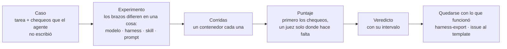

# Harness Lab

!!! info "Sobre esta página"
    **Qué vas a aprender:** qué responde el Harness Lab, cómo empezar en 30 segundos o en 15 minutos, y qué te va a decir y qué no.

    **Para quién:** developers, tech leads, AI champions y Harness Engineers que quieren evidencia en lugar de impresiones.

    **Leela cuando:** dudes de una skill, un modelo o una regla y quieras saber si de verdad ayuda.

Averiguá, con números en lugar de impresiones, si tu configuración de IA para programar funciona, y qué modelo, harness o skill la hace funcionar mejor.

Un *harness* es todo lo que rodea a un agente de código y no es el modelo: el archivo de reglas, las skills, los agentes, los hooks, el ciclo de trabajo. Los equipos suelen escribirlo a ojo. El lab lo mide. Traés una tarea, un repositorio o una skill; el lab corre agentes de código sobre eso en contenedores aislados con las configuraciones que elijas, puntúa cada corrida contra chequeos que el agente no escribió y te dice qué tan seguro está.

## Qué podés hacer

- **Revisar el harness de tu repositorio** en unos 30 segundos, sin modelo: los ocho chequeos del [chequeo de salud del harness](../../harness-completo/chequeo-de-salud.md).
- **Comparar modelos** sobre los mismos casos, varias veces cada uno: cuál hace el trabajo, y si el harness ayuda más a un modelo chico que a uno grande.
- **Medir una skill:** correr los mismos casos con y sin ella, y ver si el agente siquiera la abrió.
- **Mejorar una skill:** el lab lee las corridas, escribe un borrador de versión 2 que revisás, y prepara versión 1 contra versión 2.
- **Llevarte lo que funciona:** el harness completo, algunas skills o una sola, copiadas a tu proyecto después de una vista previa.
- **Mejorar el template compartido:** la evidencia de las corridas se convierte en un issue para `ml-python-base`, y la próxima versión se mide antes de confiar en ella.

## Empezar

**En 30 segundos, sin modelo.** Cloná el lab y apuntalo a cualquier repositorio local:

```bash
git clone https://github.com/marcosdh1987/ai-agentic-harness-lab
cd ai-agentic-harness-lab
make harness-check REPO=../tu-proyecto
```

**La aplicación web, en unos 15 minutos.** Necesitás Docker Desktop, `make`, `git` y `uv`, más una credencial (un token de Claude o tu AI gateway):

```bash
cp .env.example .env      # agregá UNA credencial
make app-up               # http://localhost:5173
```

La [guía de onboarding](https://github.com/marcosdh1987/ai-agentic-harness-lab/blob/main/docs/onboarding.md) del lab recorre la primera corrida y los problemas más comunes.

## Cómo te guía la aplicación

La pantalla de inicio pregunta "¿Qué querés probar hoy?" y ofrece algunas puertas: **modelos y harness**, **skills**, **métricas**, **benchmarks** y **tu repo**. Cada puerta abre un flujo guiado:

- **Una pregunta por paso.** Qué caso, qué agente y modelo, qué harness de base, cuántas repeticiones.
- **Un diagrama que se enciende** a medida que respondés, así siempre ves dónde estás y podés volver atrás.
- **Una revisión antes de crear nada,** con el costo estimado a partir de corridas anteriores del mismo caso y modelo. Nada se lanza sin el formulario de lanzamiento de siempre y sus chequeos de validez.

Todas las puertas siguen el mismo ciclo:

<span class="hk-chip">Elegí un caso</span> → <span class="hk-chip">Corré dos configuraciones</span> → <span class="hk-chip">Leé el veredicto</span> → <span class="hk-chip">Quedate con lo que funcionó</span>

## Seis recorridos, una página cada uno

| Querés... | Recorrido |
| --- | --- |
| Convertir una idea, un issue de SWE-bench o una tarea de tu repo en un caso de prueba | [Crear un caso](https://github.com/marcosdh1987/ai-agentic-harness-lab/blob/main/docs/journey-create-a-case.md) |
| Correrlo con distintos modelos, harnesses y skills; repetirlo; continuar una corrida que quedó corta | [Correr y comparar](https://github.com/marcosdh1987/ai-agentic-harness-lab/blob/main/docs/journey-run-and-compare.md) |
| Saber qué dice un resultado, y cuándo creerle | [Leer los resultados](https://github.com/marcosdh1987/ai-agentic-harness-lab/blob/main/docs/journey-read-results.md) |
| Auditar tu repositorio o medir tu skill | [Traé tu repo o tu skill](https://github.com/marcosdh1987/ai-agentic-harness-lab/blob/main/docs/journey-bring-your-repo-or-skill.md) |
| Llevarte el harness, o una skill, a tu proyecto | [Llevalo a casa](https://github.com/marcosdh1987/ai-agentic-harness-lab/blob/main/docs/journey-take-it-home.md) |
| Convertir lo aprendido en un template mejor | [Mejorar el template](https://github.com/marcosdh1987/ai-agentic-harness-lab/blob/main/docs/journey-improve-the-template.md) |

Los recorridos del lab están en inglés.

## Pocas skills, y que cada eliminación se la gane

Cada skill que el agente puede ver cuesta contexto en cada corrida. El lab lo contó: con 25 skills cargadas, los agentes abrieron solo 3 en 18 corridas con seis modelos. Por eso un proyecto lleva un **skill profile**: `minimal` (7 skills: planificar, depurar, verificar, investigar, revisar) es el default para proyectos nuevos, y `full` conserva todas las skills gobernadas. Los perfiles filtran, nunca borran: volver a activar una skill es una línea.

Las pruebas de poda del lab fueron chicas y no mostraron que se pueda sacar una skill gratis. La regla que salió de ahí: sacar una skill se gana con evidencia, y `minimal` crece de a una skill probada por vez (`make add-skill-trial`). Mirá [Empezá con pocas skills](../../harness-completo/pocas-skills.md).

## Llevarte un harness a casa

`make harness-export` copia a tu repositorio lo que se ganó su lugar, en tres tamaños:

| Qué te llevás | Qué recibís |
| --- | --- |
| Una skill | El archivo de la skill en la carpeta de skills de tu herramienta, nada más |
| Algunas skills y las reglas | Esas skills, el archivo de reglas, los agentes y los documentos de gobernanza |
| El harness completo | Todas las skills, agentes y reglas con los que corre el lab |

Por defecto muestra una vista previa y solo escribe con `APPLY=1`. Se niega a trabajar sobre un repositorio con cambios sin commitear, así la exportación llega como su propio diff, y guarda cualquier archivo tuyo que reemplace al lado del nuevo como `<archivo>.native.bak`. Copiar un harness que ayudó en los casos del lab es una hipótesis sobre tu repositorio, no un resultado: medilo ahí también.

## Qué te va a decir el lab, y qué no

- Mide un harness y un flujo de trabajo (reglas, skills, hooks, verificación), nunca a una persona. Ningún resultado es por developer.
- Las repeticiones deciden hasta dónde llega un resultado: una corrida es exploratoria, de dos a cuatro son un juicio, cinco o más son una validación, y cada tasa lleva su intervalo.
- Un resultado vale para los casos, el modelo y la versión del harness con los que corrió. Cada corrida registra los tres.

## Diseños de evaluación

Cada experimento declara su diseño antes de correr, y el lab rechaza un diseño que no puede responder su pregunta.

| Diseño | La pregunta | Queda fijo | Varía |
| --- | --- | --- | --- |
| Validar tu herramienta | Construí un agente, un servidor MCP o un wrapper, y una skill que lo maneja. ¿Funciona de forma confiable? | El sujeto, los casos, dónde corre | Harness y modelo |
| Evaluar un cambio del harness | ¿Este cambio de skill, regla, flujo o prompt mejora el desempeño? | Dónde corre, los casos, el modelo | La condición del harness |
| ¿Un modelo más fuerte necesita menos harness? | ¿El efecto del harness se achica a medida que crece el modelo? | Los casos, dónde corre | Nivel de harness y modelo, como grilla |
| Comparar modelos en un caso | Salió un modelo nuevo: ¿cómo le va en el caso donde probamos el anterior? | El caso, el prompt, los pasos, las repeticiones | El modelo, cada uno con su harness |
| Auditar un repositorio | ¿Qué podemos aprender de cómo este proyecto trabaja hoy con IA? | Nada; es exploratorio | Nada |

Solo "Evaluar un cambio del harness" puede respaldar una afirmación causal, y solo con suficientes repeticiones por brazo.

## Por dentro

Para quien quiere la mecánica:

- **El experimento está por encima de la corrida.** Una corrida es un dato; un experimento declara primero su pregunta y sus brazos, fija el control y se expande en corridas etiquetadas por brazo.
- **Chequeos de validez de la comparación:** confirman que los dos brazos corrieron sobre los mismos casos y commits con la misma infraestructura, y rechazan comparaciones donde cambiaron dos cosas a la vez.
- **Un registro de puntajes con procedencia:** cada métrica está versionada y marcada como *hecho* (reproducible, como un código de salida), *observación* (leída de los artefactos, como la cantidad de pasos) o *juicio* (de un modelo o una persona).
- **Atribución:** cada corrida registra un hash de condición y una huella del harness, qué skills estaban disponibles, cuáles se abrieron y cuáles ayudaron.
- **Los hallazgos los firma una persona.** Las debilidades que salen de las auditorías llegan como sugerencias y pasan a ser tareas o casos de regresión solo después de que una persona las firma.
- **Agentes y modelos:** Claude Code, OpenCode, Codex y Gemini CLI corren como harnesses; el esfuerzo de razonamiento es un parámetro de la corrida; los modelos locales (LM Studio, Ollama) están al lado de los de la nube.



| Capa | Tecnología |
| --- | --- |
| Frontend | React, TypeScript, Vite, design tokens semánticos, set local de íconos SVG |
| Backend | Python 3.11+, FastAPI, Pydantic v2, SQLModel, SQLite en modo WAL |
| Ejecución | Celery, Redis, aislamiento con un contenedor Docker por corrida y toolchains preinstaladas |
| Evaluación | Registro de puntajes, auditor de comportamiento con LLM, adaptador de DeepEval |
| Telemetría | LiteLLM AI Gateway, tracing con Langfuse |
| Gates de calidad | `uv`, `ruff`, `pytest`, `make check` |

## Repositorios

El desarrollo ocurre en [`xmartlabs/sdlc-ml-python-harness-lab`](https://github.com/xmartlabs/sdlc-ml-python-harness-lab), la plataforma de evaluación desarrollada en Xmartlabs. [`marcosdh1987/ai-agentic-harness-lab`](https://github.com/marcosdh1987/ai-agentic-harness-lab) es su espejo público, que se sincroniza en cada versión de upstream; los comandos de esta página usan el espejo.

## Recursos relacionados

- [Flujo de evaluación en el lab](evaluation-workflow.md): los patrones de experimento paso a paso.
- [Las tres preguntas](../../evaluation/the-three-questions.md): la metodología de evaluación.
- [Chequeo de salud del harness](../../harness-completo/chequeo-de-salud.md): los ocho chequeos como checklist.
- [Harnesses adaptativos](../../evaluation/adaptive-harnesses.md): retirar andamiaje que un modelo más fuerte ya no necesita.
